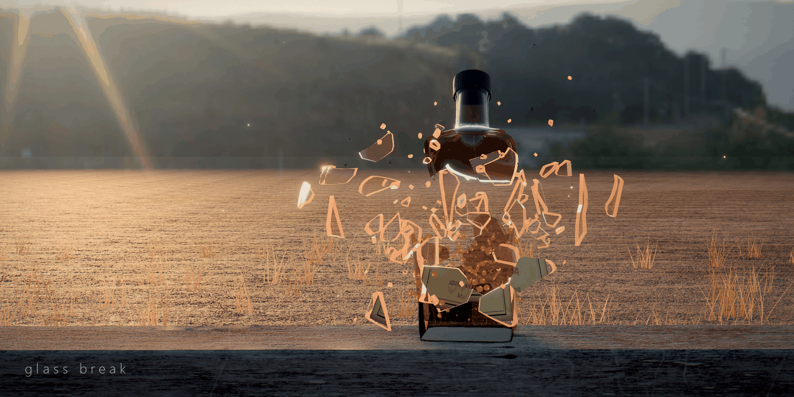

# glass break

A photorealistic glass-bottle shooting gallery in the browser: bottles on a fence at golden hour, shattered in slow motion.



## Features

- **Realistic glass** – refraction, thickness, rim lighting and coloured beer, whiskey and soda bottles, some filled with liquid.
- **Voronoi fracture** – every hit breaks the bottle into its own set of shards, with cracks, needles and powder.
- **Slow motion** – impacts drop into bullet time so you can watch the shards and the liquid splash.
- **Synthesized Web Audio** – the gunshots, shattering, tinkling shards and splashes are all generated at runtime, with no audio files.
- **Cinematic intro** – open with `?cinematic` or press **C** to play it. A recorded version is in `glass-intro.mp4`.

## Controls

| Input | Action |
| --- | --- |
| Left click | Shoot |
| Right click | Zoom |
| R | Reset bottles |
| C | Play cinematic intro |
| Esc | Pause |

## Run

```bash
pnpm install
pnpm dev
```

Then open http://127.0.0.1:5173/.

## Tech

three.js · Vite · TypeScript · Web Audio API (no audio files)
